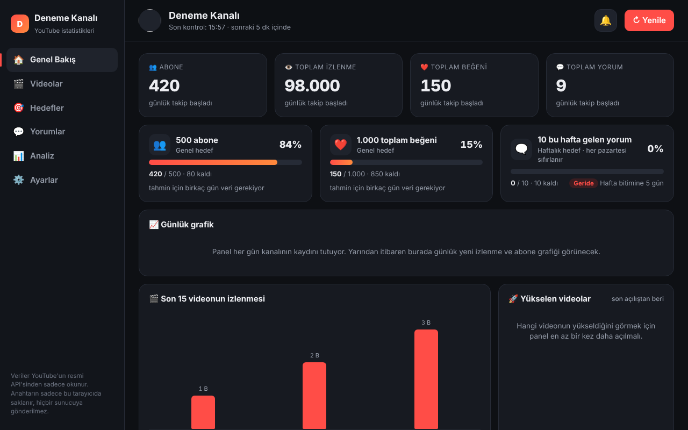
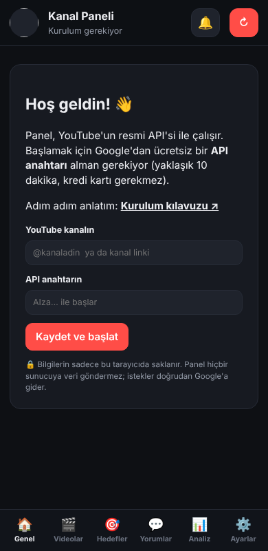

# 📊 Kanal Paneli

YouTube kanalın için **ücretsiz ve açık kaynak** bir istatistik paneli. Kendi API anahtarınla çalışır. Kurulum yaklaşık 10 dakika sürer, kredi kartı gerekmez.

**👉 Hemen kullan:** https://falconcompany19.github.io/kanal-paneli/

> Bu proje YouTube'un ya da Google'ın resmi bir ürünü değildir. Sadece YouTube Data API'sini kullanan bağımsız bir araçtır.

---

## ✨ Neler var?

| Bölüm | İçerik |
|---|---|
| 🏠 **Genel Bakış** | Abone, izlenme, beğeni ve yorum sayıları; son 24 saatte ve 7 günde ne kadar arttıkları. Günlük grafikler, yükselen videolar. |
| 🎬 **Videolar** | Shorts / uzun video filtresi, arama, 8 farklı sıralama. Ortalamanın üstünde giden videolarda 🔥 ve ⬆ etiketi. CSV (Excel) dışa aktarma. |
| 🎯 **Hedefler** | "100 abone", "1.000 beğeni", "bu hafta 10 yorum" gibi hedefler. İlerleme çubuğu, "bu hızla ~12 gün" tahmini, rozetler ve 🎉 kutlama. Para kazanma (İş Ortağı Programı) takibi. |
| 💬 **Yorumlar** | Son yorumlar, cevaplanmamış yorumlar, en çok yorum yapan izleyiciler, sık geçen kelimeler. |
| 📊 **Analiz** | En iyi paylaşım günü ve saati, en iyi Shorts süresi, başlık analizi, yükleme takvimi. |
| 🔔 **Yeni yorum uyarısı** | Panel açıkken her dakika yeni yorumlara bakar. Yeni yorum gelince zil, ses ve sekme başlığında sayı çıkar. |

Telefonda da çalışır: ekran küçülünce menü alta geçer. Telefonda Chrome menüsünden **"Ana ekrana ekle"** dersen uygulama gibi açılır.

---

## 🔒 Güvenlik ve gizlilik

- Panel **şifreni istemez** ve Google hesabına giriş yapmaz.
- Sadece YouTube'daki **herkese açık** verileri **okur**. Hiçbir şey paylaşamaz, silemez, değiştiremez.
- API anahtarın ve tüm kayıtların (hedefler, günlük geçmiş) **sadece senin tarayıcında** saklanır. Bu sitenin bir sunucusu yoktur; istekler doğrudan tarayıcından Google'a gider.
- Kod tamamen açık: [`index.html`](index.html) dosyasında neler olduğunu herkes görebilir.
- Ortak kullanılan bir bilgisayardaysan işin bitince **Ayarlar → Her şeyi sil** de.

---

## Kurulum

Panelin çalışması için Google'dan ücretsiz bir **API anahtarı** alman gerekiyor. Her kullanıcı kendi anahtarını alır, böylece kota senin hesabından düşer.

> Google'ın ekranları bazen Türkçe, bazen İngilizce görünür. Her adımda iki dildeki adı da yazdık: **Türkçe (English)**

### 1. adım: Proje oluştur

1. https://console.cloud.google.com adresine git ve Google hesabınla giriş yap. İlk girişte kullanım şartlarını kabul etmen istenebilir.
2. Sayfanın en üstündeki **Proje seçin (Select a project)** kutusuna tıkla.
3. Açılan pencerede **Yeni Proje (New Project)** de.
4. Proje adına mesela `Kanal Paneli` yaz, **Oluştur (Create)**'a bas.
5. Birkaç saniye bekle, sonra üstten bu projeyi seçili hale getir.

### 2. adım: YouTube Data API'yi aç

1. Sol üstteki ☰ menüden **API'ler ve Hizmetler (APIs & Services) → Kitaplık (Library)**'a gir.
2. Arama kutusuna `YouTube Data API v3` yaz.
3. Çıkan sonuca tıkla, **Etkinleştir (Enable)**'e bas.

### 3. adım: API anahtarını oluştur

1. ☰ menüden **API'ler ve Hizmetler (APIs & Services) → Kimlik Bilgileri (Credentials)**'e gir.
2. Üstteki **+ Kimlik bilgisi oluştur (+ Create credentials) → API anahtarı (API key)**'na bas.
3. `AIza...` ile başlayan uzun bir anahtar çıkacak. Kopyala.

### 4. adım: Anahtarı kısıtla (güvenlik için önemli)

Bu adım sayesinde anahtar bir gün başkasının eline geçse bile sadece YouTube'daki herkese açık verileri okumak için, sadece senin seçtiğin yerden kullanılabilir.

1. Aynı sayfada anahtarının adına tıkla (**Anahtarı düzenle / Edit API key**).
2. **API kısıtlamaları (API restrictions)** kısmında **Anahtarı kısıtla (Restrict key)**'ı seç ve listeden sadece **YouTube Data API v3**'ü işaretle.
3. **Uygulama kısıtlamaları (Application restrictions)** kısmını, paneli nasıl kullanacağına göre ayarla:

   | Paneli nereden açacaksın? | Ne seçmelisin? |
   |---|---|
   | Sitesinden (`falconcompany19.github.io`), **önerilen** | **Web siteleri (Websites)** seç ve şu adresi ekle: `https://falconcompany19.github.io/*` |
   | Bilgisayarına indirip `Paneli_Ac.bat` ile | **Web siteleri (Websites)** seç ve şu adresi ekle: `http://localhost:8765/*` |
   | İkisi birden | İki adresi de ekle |
   | `index.html` dosyasına çift tıklayarak | **Yok (None)** olarak bırak (dosyadan açılan sayfalar adres bilgisi göndermez) |

4. **Kaydet (Save)**'e bas. Ayarın yerleşmesi birkaç dakika sürebilir.

### 5. adım: Paneli aç

1. https://falconcompany19.github.io/kanal-paneli/ adresine git.
2. **YouTube kanalın** kutusuna kanalının `@kullanıcıadı`nı ya da kanal linkini yapıştır.
3. **API anahtarın** kutusuna anahtarı yapıştır.
4. **Kaydet ve başlat**'a bas. Hepsi bu! 🎉

---

## 💻 İstersen bilgisayarında çalıştır (Windows)

Site yerine kendi bilgisayarında kullanmak istersen:

1. Bu sayfada yeşil **Code** butonuna bas, **Download ZIP** de, sonra zip'i bir klasöre çıkar.
2. `Paneli_Ac.bat` dosyasına çift tıkla. Küçük bir siyah pencere açılır ve panel tarayıcıda kendiliğinden açılır. Bu pencere sadece senin bilgisayarından erişilebilen küçük bir yerel sunucudur, internete açık değildir. Paneli kullandığın sürece açık kalmalı.
3. 4. adımdaki tabloya göre anahtarına `http://localhost:8765/*` adresini eklemeyi unutma.

---

## ❓ Sık karşılaşılan sorunlar

| Mesaj | Çözüm |
|---|---|
| **API anahtarı geçersiz** | Anahtar eksik kopyalanmış olabilir. **Ayarlar → API anahtarı → Değiştir**'den yeniden yapıştır. |
| **YouTube Data API bu projede açık değil** | 2. adımı yap, birkaç dakika bekleyip **Yenile**'ye bas. Anahtarın, API'yi açtığın projede oluşturulduğundan emin ol. |
| **Anahtar kısıtlaması bu isteği engelledi** | 4. adımdaki tabloya bak. Paneli açtığın adres, anahtarın "Web siteleri" listesinde olmalı. |
| **Kanal bulunamadı** | Kanal adını `@` ile birlikte yaz ya da kanal sayfanın linkini yapıştır. |
| **Bugünkü kullanım hakkı doldu** | Google günde 10.000 birim ücretsiz hak verir ve kota her gün sıfırlanır. **Ayarlar**'dan otomatik güncelleme aralığını uzat. |

**Notlar:**
- Günlük grafikler ve tahminler panelin her gün tuttuğu kayıtlardan hesaplanır. Paneli her gün en az bir kez açarsan grafikler dolar. Kayıtlar her tarayıcıda ayrı tutulur.
- 3 dakikaya kadar olan videolar "Shorts" sayılır.
- Abone sayısı YouTube'un herkese gösterdiği yuvarlanmış sayıdır.

Bir hata bulursan ya da fikrin varsa [Issues](https://github.com/FALCONcompany19/kanal-paneli/issues) bölümünden yazabilirsin. **Anahtarını asla paylaşma.**

---

## 📄 Lisans

[MIT](LICENSE). Ücretsiz kullanabilir, değiştirebilir ve paylaşabilirsin.
